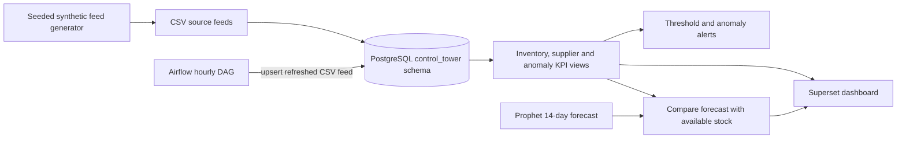

# DA-03 | Retail & Supply Chain Control Tower

**Data Analytics specialization · Project 2 of 2**

This project is a small, explainable control tower prototype. It turns inventory, demand, shipment, and supplier feeds into a few practical questions: What could run out? Which deliveries are late? Is demand behaving unusually? Would a one-week delay leave enough stock?

The included feeds are **synthetic** and created for this portfolio demo. No live retailer, supplier, shipment, or customer records are used. The hourly Airflow schedule, PostgreSQL service, Prophet forecast, Superset dashboard, and alert delivery are implementation assets; they are not represented as deployed services.

## At a glance

- 12 fictional products across 4 fictional suppliers.
- 36 inventory rows across 3 warehouses in one snapshot.
- 1,080 daily demand rows across 90 days.
- 48 synthetic shipments with planned and actual delivery dates.
- PostgreSQL schema and KPI views, an hourly Airflow DAG, a demand anomaly check, an optional Prophet forecast, a 7-day delay scenario, and a Superset dashboard plan.
- A CSV validation run passed 9 checks. The generated demonstration snapshot has a 5.6% stock-out rate and 35.4% supplier on-time rate; these are synthetic scenario values, not real operational benchmarks.

## Architecture



For this demo, the feeds are files rather than live supplier APIs. Airflow shows how an hourly refresh would be scheduled; it re-reads and upserts the current synthetic CSVs. A live retailer would replace that input with authenticated source integrations and operational monitoring.

## What is included

| Folder | Contents |
|---|---|
| `data/` | Generated synthetic CSV feeds |
| `Retail_Supply_Chain_Control_Tower_Data.xlsx` | One workbook with an overview, the five data tables on filterable sheets, and a data dictionary |
| `python/` | PowerShell CSV generator, CSV KPI/anomaly summary, optional Prophet forecast, requirements |
| `sql/` | PostgreSQL tables, KPI views, anomaly view, 7-day delay what-if, CSV import script |
| `airflow/dags/` | Hourly refresh DAG using a PostgreSQL Airflow connection |
| `superset/` | Dashboard and connection setup guidance |
| `alerts/` | Console alert checker and optional Slack webhook behavior |
| `tests/` | CSV contract tests and the PowerShell validation used for the included data |
| `docs/` | Data dictionary, demo walkthrough, and reflection template |

## Data inventory

| File | Rows | Main fields |
|---|---:|---|
| `data/products.csv` | 12 | SKU, supplier, unit cost, reorder point |
| `data/suppliers.csv` | 4 | Supplier, region |
| `data/inventory_snapshot.csv` | 36 | Snapshot time, SKU, warehouse, on-hand, allocated |
| `data/daily_demand.csv` | 1,080 | Date, SKU, units sold |
| `data/shipments.csv` | 48 | Supplier, SKU, order/promised/actual dates, units |

Every CSV row includes `synthetic_record=true`. The generator uses a fixed seed, making the demo scenario reproducible. It deliberately seeds several low-stock and demand-spike cases so the control-tower checks have something to flag.

The Excel workbook is a convenient combined copy for review. The CSV files remain the source inputs used by the SQL and pipeline examples.

## Run it locally

Visual Studio Code is optional. The commands below can be run from PowerShell or another terminal. Start in this project directory.

### 1. Generate the CSV feeds

Windows PowerShell requires no extra packages for generation:

```powershell
powershell -ExecutionPolicy Bypass -File python/generate_data.ps1
```

The generated files appear in `data/`. The same structure can be generated with a Python implementation in a later extension; the included reliable Windows generator is PowerShell.

### 2. Validate the generated data

```powershell
powershell -ExecutionPolicy Bypass -File tests/validate_csvs.ps1
```

Expected checks: 12 products, 4 suppliers, 36 inventory rows, 1,080 demand rows, 48 shipments, synthetic labels on every row, and valid product/supplier relationships. The checks run on the included CSV files.

### 3. Start PostgreSQL and load the CSVs

Install Docker Desktop, then copy the sample local settings file and change its password:

```powershell
Copy-Item .env.example .env
```

Start the database from this folder:

```powershell
docker compose up -d
```

On the first start, the container creates the schema and imports the mounted CSV files. The example is local-only. `.env` is ignored by Git; never commit a real password. To inspect the database:

```powershell
docker compose exec postgres psql -U controltower -d controltower -c "SELECT * FROM control_tower.v_supplier_kpis;"
docker compose exec postgres psql -U controltower -d controltower -c "SELECT * FROM control_tower.v_inventory_kpis LIMIT 10;"
```

PostgreSQL runs on port 5432 by default. The init scripts run only when the database volume is first created. For a changed CSV snapshot, use a safe upsert refresh such as the Airflow DAG or re-import into a fresh disposable local database.

### 4. Review KPIs and anomalies without a database

If Python is installed, run:

```powershell
python python/analyze.py
python alerts/check_alerts.py
```

The analysis reports the synthetic snapshot’s stock-out and on-time delivery rates, then flags daily demand values whose absolute z-score is at least 2.5. The alert checker prints low-stock and demand-anomaly messages. It sends nothing unless `SLACK_WEBHOOK_URL` is explicitly configured in the environment.

### 5. Optional demand forecast

Install the packages from `python/requirements.txt` in an isolated Python environment, then run:

```powershell
python python/forecast_prophet.py
```

The script holds out the latest 14 historical days for per-SKU Prophet MAE/WAPE comparison with a simple mean-demand baseline, then refits on the full history and forecasts the next 14 days. It writes `data/forecast_holdout_metrics.csv` and `data/demand_forecast_14d.csv`, including a simple comparison of forecast demand with current available inventory. Forecast output is synthetic and should not be treated as a validated purchasing recommendation. The Prophet script was not run in the authoring environment because Python and its dependencies were unavailable.

### 6. Airflow hourly refresh

`airflow/dags/control_tower_hourly.py` defines a DAG scheduled at the top of every hour. To run it in Airflow, install the matching Apache Airflow Postgres provider, make the project `data/` files available at the DAG’s expected relative path, and configure an Airflow connection with ID `control_tower_pg` for the local PostgreSQL database. The DAG upserts the CSV feed into the schema. Airflow itself was not installed or deployed for this portfolio build.

### 7. Superset dashboard and what-if

Connect Apache Superset to the PostgreSQL database and use `superset/dashboard_guide.md` to build the KPI cards, warehouse stock chart, supplier performance table, demand-anomaly chart, and 7-day delay what-if view. The `control_tower.v_delay_7d_whatif` view subtracts seven days of average demand from available units and flags projected stock-outs. No Superset instance or dashboard export is included.

## KPI definitions

- **Stock-out rate:** inventory SKU/warehouse rows with available units at or below zero divided by all snapshot rows. Available units = `max(on_hand − allocated, 0)`.
- **On-time delivery:** delivered shipments where actual delivery date is on or before the promised date, divided by delivered shipments.
- **Supplier lead time:** average calendar days from order date to actual delivery date.
- **Days of inventory:** available units divided by average daily demand from the recent 30-day window. Null where demand is zero.
- **Demand anomaly:** absolute z-score of daily SKU demand at least 2.5.
- **7-day delay scenario:** current available units minus seven times the average daily demand; flags when the result is at or below zero.

These definitions are intentionally simple and should be reviewed with business owners before use in a real operation.

## Validation results

The included `tests/validate_csvs.ps1` was run against the generated CSVs:

| Check | Result |
|---|---|
| Expected row counts across all five CSVs | PASS |
| Every source row marked synthetic | PASS |
| Product-to-supplier references | PASS |
| Inventory and demand SKU references | PASS |
| Shipment SKU and supplier references | PASS |
| Snapshot stock-out rate | 5.6% (synthetic) |
| Shipment on-time rate | 35.4% (synthetic) |

Python `unittest` contract checks are also included in `tests/test_data_contract.py`, but have not been run here. PostgreSQL, Airflow, Prophet, and Superset integration results are not claimed because those services were not deployed in the authoring environment.

## Demo and presentation

See `docs/demo_walkthrough.md` for a short walkthrough and `docs/presentation_outline.md` for a 10-minute presentation plan. `docs/reflection_template.md` is provided for an individual reflection; fill it in with your own experience rather than presenting it as someone else’s.

## References

- [Apache Airflow DAGs](https://airflow.apache.org/docs/apache-airflow/stable/core-concepts/dags.html)
- [PostgreSQL documentation](https://www.postgresql.org/docs/)
- [Prophet documentation](https://facebook.github.io/prophet/)
- [Apache Superset documentation](https://superset.apache.org/docs/intro)
