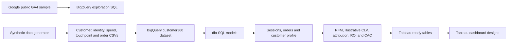

[README.md](https://github.com/user-attachments/files/35119352/README.md)
# Customer 360 Marketing Analytics

A project that brings together public GA4 ecommerce data and a clearly labeled synthetic customer marketing dataset. The goal is to explore customer behavior, demonstrate identity mapping, calculate marketing metrics, and prepare data for Tableau. ~ Tejas shrirame

## What I did

1. Planned the data sources.Selected Google’s public, obfuscated GA4 ecommerce sample and designed synthetic CRM, advertising, touchpoint, and order data.
2. Generated synthetic data. Created 1,000 fictional customer profiles and identity links, 120 monthly campaign-spend rows, 2,437 touchpoints, and 2,394 orders. All generated records are labeled synthetic. They do not represent real people, customers, or company performance.
3. Prepared identity mapping.** Added a demonstration bridge from each synthetic web user ID to a synthetic CRM customer ID. This is a simple portfolio example, not production identity resolution.
4. Prepared dbt-style models.** Wrote SQL models for sessions, orders, and customer profiles under `dbt/models/`.
5. Prepared analytics SQL.** Added queries for RFM scoring, an illustrative CLV proxy, first-touch, last-touch, linear and time-decay attribution, campaign ROI, and CAC.
6. Prepared Tableau guidance.** Documented three dashboard layouts and metric definitions under `tableau/`.


## Project files

- `data/` — generated synthetic CSV files for customers, identity links, ad spend, touchpoints, and orders.
- `python/generate_synthetic_data.py` — Python generator (standard library only).
- `python/generate_synthetic_data.ps1` — Windows PowerShell fallback used to create the included CSVs in this environment.
- `sql/00_ga4_exploration.sql` — public GA4 sample exploration queries; not run from this environment.
- `sql/01_bigquery_setup_and_load.sql` — BigQuery dataset and table setup guidance.
- `dbt/` — dbt project configuration and sessions, orders, and customer profile models; not executed.
- `sql/02_customer_metrics.sql` — RFM, illustrative CLV, attribution, ROI, and CAC SQL; not executed.
- `tableau/dashboard_guide.md` — Tableau-ready dashboard design and definitions; no Tableau workbook is included.
# Customer 360 Marketing Analytics

Data and completion note:** Every CRM, identity, advertising, touchpoint, and order row in `data/` is synthetic. The public GA4 sample was not queried from this environment because the BigQuery console was unavailable. BigQuery/dbt SQL and Tableau designs are included as reproducible project work, but they have not been executed or validated against a live account. No business findings are claimed.

## Project architecture



The GA4 sample exploration is intentionally separate from the synthetic funnel. No generated customer or order record is represented as a GA4 user or event.

## Features and deliverables

- **GA4 exploration:** BigQuery Standard SQL for discovering tables, event volumes, event names, traffic-source fields, purchase events, and event parameter keys.
- **Synthetic dataset:** 1,000 fictional customer profiles and identity links, monthly campaign spend, synthetic touchpoints, and synthetic orders. Each CSV has a `synthetic_record` indicator.
- **Identity mapping:** Demonstration bridge between generated `user_pseudo_id` and `customer_id` values.
- **Transformations:** dbt-style BigQuery SQL models for sessions, orders, and customer profiles.
- **Customer and marketing metrics:** RFM quintiles, an illustrative CLV proxy, first-touch, last-touch, linear, and time-decay attribution, campaign ROI, and CAC.
- **Visualization plan:** Tableau dashboard layouts, chart suggestions, filters, and metric definitions.

## Repository layout

```text
customer360/
├── README.md
├── data/                         # Generated synthetic CSVs
├── dbt/
│   ├── dbt_project.yml
│   ├── profiles.yml.example      # Example only; put real profile in your user config
│   └── models/
│       ├── sessions.sql
│       ├── orders.sql
│       └── customer_profile.sql
├── python/
│   ├── generate_synthetic_data.py
│   └── generate_synthetic_data.ps1
├── sql/
│   ├── 00_ga4_exploration.sql
│   ├── 01_bigquery_setup_and_load.sql
│   └── 02_customer_metrics.sql
└── tableau/
    └── dashboard_guide.md
```

## Dataset inventory

The included CSVs were generated with the PowerShell fallback in this environment:

| File | Rows | Description |
|---|---:|---|
| `data/crm_customers.csv` | 1,000 | Fictional customer profiles |
| `data/identity_map.csv` | 1,000 | Synthetic user-to-customer links |
| `data/ad_spend.csv` | 120 | Monthly synthetic spend by campaign |
| `data/touchpoints.csv` | 2,437 | Synthetic campaign interactions |
| `data/synthetic_orders.csv` | 2,394 | Synthetic orders and revenue |

## Setup and run instructions

### 1. Generate or regenerate the synthetic CSVs

On Windows, run from this project folder in PowerShell:

```powershell
powershell -ExecutionPolicy Bypass -File python/generate_synthetic_data.ps1
```

Alternatively, with Python installed, run:

```bash
python python/generate_synthetic_data.py
```

The Python generator uses only the standard library. Each generator is seeded for repeatability; their specific synthetic rows can differ from each other, but both use the same file names, columns, and synthetic labels.

### 2. Explore the public GA4 dataset

Open `sql/00_ga4_exploration.sql` in BigQuery Studio and run its queries individually against:

```text
bigquery-public-data.ga4_obfuscated_sample_ecommerce.events_*
```

Use Google Cloud project `ace-mote-465005-k4` only if it is still available to you, and ensure the BigQuery API and permissions are set up. Review the query’s processed-byte estimate before running it. The public sample is obfuscated and covers November 1, 2020 through January 31, 2021; it is not the synthetic dataset in this repository.

### 3. Load synthetic CSVs into BigQuery

Create a BigQuery dataset named `customer360` in the **US** location, then upload each file from `data/` as a table with the same base name:

| CSV | BigQuery table |
|---|---|
| `crm_customers.csv` | `crm_customers` |
| `identity_map.csv` | `identity_map` |
| `ad_spend.csv` | `ad_spend` |
| `touchpoints.csv` | `touchpoints` |
| `synthetic_orders.csv` | `synthetic_orders` |

Enable header-row handling and schema autodetection for each upload. Then review and run the integrity-check section of `sql/01_bigquery_setup_and_load.sql`. The SQL currently uses project ID `ace-mote-465005-k4`; replace it with your own project ID if needed.

### 4. Run dbt models

Install dbt for BigQuery in your Python environment:

```bash
python -m pip install dbt-bigquery
```

Copy `dbt/profiles.yml.example` to your dbt user configuration directory as `profiles.yml` (on Windows, usually `%USERPROFILE%\.dbt\profiles.yml`). Confirm the project ID and dataset location match your BigQuery setup. Authenticate using your organization’s approved Google Cloud method, then run from the `dbt/` directory:

```bash
dbt debug
dbt build
```
## 5. Calculate analytics

After the dbt models build successfully, open `sql/02_customer_metrics.sql`. Confirm the project and dataset names, then run the statements in order. The resulting `rfm`, `attribution`, and `campaign_performance` tables are based on the synthetic funnel.

### 6. Build Tableau views

Connect Tableau to the BigQuery tables `customer360.rfm`, `customer360.attribution`, and `customer360.campaign_performance`, or export those tables to CSV. Follow `tableau/dashboard_guide.md` for customer value, campaign performance, and attribution-path dashboard designs. A Tableau workbook is not included.

## Metric definitions and assumptions

- **RFM:** Recency, frequency, and monetary value are divided into quintile scores. Recency is scored so more recent activity receives the better score.
- **Illustrative CLV:** Observed synthetic revenue over the generated 12-month period, expressed as a simple historical customer-value proxy. It is not a predictive model.
- **Attribution window:** Synthetic campaign touches during the 30 days before each order.
- **Time decay:** Exponential decay with a 7-day half-life.
- **ROI:** `(attributed revenue - ad spend) / ad spend`.
- **CAC:** `ad spend / distinct customers with attributed orders`.

## Implementation status

| Component | Status |
|---|---|
| Synthetic CSVs | Generated and included |
| GA4 exploration SQL | Prepared; not run in this environment |
| BigQuery upload and table checks | Instructions and SQL prepared; not run |
| dbt models | Prepared; not built or validated against BigQuery |
| Customer and campaign metrics | SQL prepared; not executed |
| Tableau dashboard specification | Prepared; workbook not built |


# Metric assumptions

- **RFM:** recency, purchase frequency, and monetary value are ranked into quintiles.
- **Illustrative CLV:** a simple historical-value proxy, not a predictive forecast.
- **Attribution:** eligible synthetic touchpoints within 30 days before an order; time decay uses a 7-day half-life.
- **ROI:** (attributed revenue − ad spend) / ad spend.
- **CAC:** ad spend / unique customers with attributed orders.
